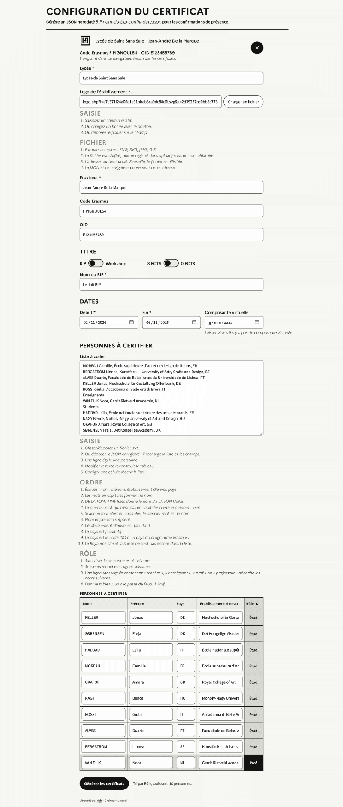

# ERASMUS-confirmation-of-attendance
Un outil en ligne pour générer les certificats de présence, pour les Blended Intensive Program (BIP) ou simple Workshop Erasmus.
Parce que les fichiers Word moches, c'est non!

On se prend le bec avec mon Eraei (sur l'obligation du Bilinguisme). Le document généré (pdf) est en anglais pour les étrangers, une copie en français pour archive est générée en fin de doc. Une nouvelle option permet de générer un certificat recto/verso bilingue (cf. Update).

L'outil est constitué de deux pages,

## Une page de configuration :
où l'on renseigne la première fois qu'on l'utilise les infos de l'établissement émetteur avec le logo, les IOD et le code erasmus de l'établissement et le nom du·de la proviseur·e (le·a responsable légal·e). Et une liste des étudiants avec leur établissement d'origine et leur pays, qui ont participé. Ces infos sont mémorisées dans le navigateur et dans le fichier de config qu'on télécharge en changeant de page.

## Une page de génération des certificats
à partir des données collectées sur la première, en anglais et une copie pour archive en français en fin de document.  
Il suffit d'imprimer (**Command/Control** + **P**) pour obtenir le pdf, les documents à faire signer par le·a chef·fe d'établissement.

il faut héberger sur un serveur (en https://). Les technos ne fonctionnent pas en local (en file://).

On définit le type de projet (__BIP__ ou __Workshop__) et le nombre d'ects est ajouté au certificat (3 ou 1).  
La liste du configurateur, contient les _étudiants_ et les _accompagnants_, l'_établissement d'origine_ et le _pays_.
Un tableau se construit à chaque ligne ajoutée dans le champs.  
On peut sélectionner le **rôle** (etudiant/enseignant) pour chaque personne.   
Le certificat n'est pas le même (en fonction du rôle), il octroie des ects aux étudiants et déclare la présence de l'enseignant comme accompagnant (pas d'octroie d'ects).  
Il semblerait que les infos légales nécessaires sont toutes présentes sur le doc (validé par un agent ia)

Je me suis un peu amusé à travailler avec une grille de ligne de base pour la mise en forme du certificat pour que ce soit un peu structuré visuellement. Les lignes bleues ne sont pas imprimées dans le pdf (il y a un bouton pour montrer/cacher ces lignes).  
La gestion de la grille de ligne de base est inspirée du travail de [Julie Blanc](https://www.julie-blanc.fr) pour [pagedjs](https://pagedjs.org/)

Le doc utilise la typo __Marianne__, de la marque République Française®. Comme c'est un document officiel, on respecte son usage.

J'ai tenté de rendre l'interface intuitive, on verra à l'usage si c'est le cas.

- On peut glisser-déposer des listes ou un fichier json précédemment exporté.
- On peut classer la liste par pays, établissement, nom, prénom, rôle... (ça ordonne aussi les certificats dans le pdf).

Le pdf contient en premier les certificats à imprimer et signer, ensuite la version française pour archive (pour faire plaisir à mon ERAIE).

Bref c'est un outil qui devrait faire gagner du temps aux enseignants qui doivent se taper ce genre de doc chronophage dont on ne dispose jamais du bon modèle et qu'on remplit à la main dans chaque fichier sauf a avoir un diplôme en bureautique et publipostage.   

Comme je suis particulièrement hermétique aux documents Word (moche, mise en page contre intuitive, souveraineté, format propriétaire, etc), j'ai opté pour un format et une technologie ouvert·e·s (pas de logiciel de bureautique à installer).

Bien sûr c'est vibecodé (avec Grok sur cursoria).

----
**Le bilinguisme (ce que dit la loi) :**
> Une attestation délivrée par un établissement public français est un document officiel. En l'absence de version française, l'établissement ne dispose pas de version juridiquement authentique de son propre acte, ce qui crée une insécurité en cas de contrôle (agence nationale, corps d'inspection, contentieux) ou de litige sur les dates ou les crédits figurant au document. La version française est donc la version de droit, et la version anglaise une traduction de facilité destinée au partenaire étranger. L'article 3 de la loi Toubon prévoit toutefois une exception pour les documents « destinés à des étrangers », ce qui tempère la portée de l'obligation pour les attestations adressées exclusivement à des établissements étrangers ( [loi n° 94-665, Légifrance](https://www.legifrance.gouv.fr/jorf/id/JORFTEXT000000349929)).

Update :
---
- Ordre des certificats. Une gélule choisit entre « recto/verso bilingue » et « Français en fin de document ». Le premier est le réglage par défaut : page anglaise, puis page française, pour chaque personne. Le second groupe toutes les pages françaises à la fin. La gélule est sur la configuration, à côté de « Générer les certificats », et sur la page des certificats, au-dessus du choix de fichier. Le choix est enregistré dans le JSON (ordreLangues) et dans le navigateur. Ouverte depuis la configuration, la page des certificats reprend ce choix.
- Ordre des personnes. À l’enregistrement du JSON, la liste est classée par établissement, puis enseignants avant étudiants, puis par nom (cela fait sens pour la découpe des pdf pour la ventilation par établissement). Le tableau à l’écran n’est pas réordonné.
- Page française. Le nom du·de la proviseur·e, le code Erasmus et l’OID n’y figurent plus. Ils restent sur la page anglaise.
- Nom du BIP reste en place au rechargement de la configuration, comme les autres infos.
