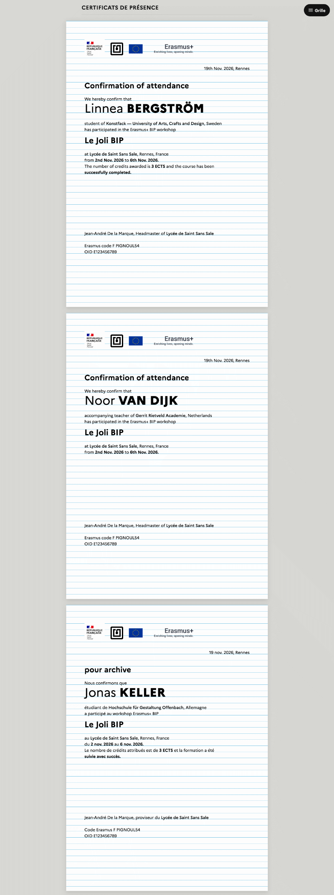

# ERASMUS-confirmation-of-attendance
Un outil en ligne pour générer les certificats de présence, pour les Blended Intensive Program (BIP) ou simple Workshop Erasmus.
Parce que les fichiers Word moches, c'est non!

On se prend le bec avec mon Eraie (sur l'obligation du Bilinguisme). Le document généré (pdf) est en anglais pour les étrangers, une copie en français pour archive est générée en fin de doc.

L'outil est constitué de deux pages,

- une page de configuration où l'on renseigne la première fois qu'on l'utilise les infos de l'établissement émetteur avec le logo, les IOD et le code erasmus de l'établissement et le nom du·de la proviseur·e (le·a responsable légal·e). Et une liste des étudiants avec leur établissement d'origine et leur pays, qui ont participé. Ces infos sont mémorisées dans le navigateur et dans le fichier de config qu'on télécharge en changeant de page.
- une seconde page génère les certificats à partir des données collectées sur la première en Anglais et une copie pour archive en Français. il suffit d'imprimer (Command/Control + P) pour obtenir en pdf, les documents à faire signer par le·a chef·fe d'établissement.

il faut héberger sur un serveur (en https://). Les technos ne fonctionnent pas en local (en file://).

La liste du configurateur, contient les étudiants et les accompagnants, l'école et le pays, un tableau se construit à chaque ligne ajoutée dans le champs.On peut sélectionner le rôle (etudiant/enseignant) pour chaque personne.Le certificat n'est pas le même (en fonction du rôle), il octroie des ects aux étudiant et déclare la présence de l'enseignant comme accompagnant (pas d'octroie d'ects).On définit le type de projet (BIP ou Workshop) et le nombre d'ects est ajouté au certificat.Il semblerait que les infos légales nécessaires sont toutes présentes sur le doc (validé par un agent ia)

Je me suis un peu amusé à travailler avec une grille de ligne de base pour la mise en forme du certificat pour que ce soit un peu structuré visuellement. Les lignes bleues ne sont pas imprimées dans le pdf (il y a un bouton pour montrer/cacher ces lignes).  
La gestion de la grille de ligne de base est inspirée du travail de [Julie Blanc](https://www.julie-blanc.fr) pour [pagedjs](https://pagedjs.org/)

Le doc utilise la typo Marianne, de la marque République Française. Comme c'est un document officiel, on peut l'utiliser.

Ce n'est pas très compliqué à utiliser (enfin j'espère), j'ai œuvré pour le rendre intuitif, on verra à l'usage si c'est le cas.

On peut glisser déposer des listes ou un fichier json précédemment exporté.

On peut classer la liste par pays, établissement, nom, prénom, rôle... (ça ordonne aussi les certificats dans le pdf).

Le pdf contient en premier les certificats à imprimer et signer, ensuite la version française pour archive (pour faire plaisir à mon ERAIE).

Bref c'est un outil qui devrait faire gagner du temps aux enseignants qui doivent se taper ce genre de doc chronophage dont on ne dispose jamais de modèle ou alors très très moche.  
Comme je suis particulièrement hermétique aux documents Word (souveraineté, format propriétaire, etc), j'ai fait le choix d'un format ouvert et d'une techno web (pas de logiciel supplémentaire).

**Le bilinguisme (ce que dit la loi) :**
> Une attestation délivrée par un établissement public français est un document officiel. En l'absence de version française, l'établissement ne dispose pas de version juridiquement authentique de son propre acte, ce qui crée une insécurité en cas de contrôle (agence nationale, corps d'inspection, contentieux) ou de litige sur les dates ou les crédits figurant au document. La version française est donc la version de droit, et la version anglaise une traduction de facilité destinée au partenaire étranger. L'article 3 de la loi Toubon prévoit toutefois une exception pour les documents « destinés à des étrangers », ce qui tempère la portée de l'obligation pour les attestations adressées exclusivement à des établissements étrangers ( [loi n° 94-665, Légifrance](https://www.legifrance.gouv.fr/jorf/id/JORFTEXT000000349929)).

Bien sûr c'est vibecodé avec Grok sur cursoria.
