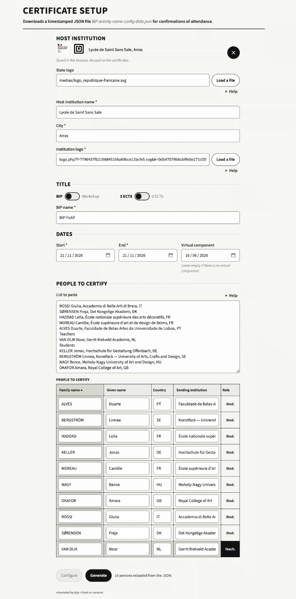
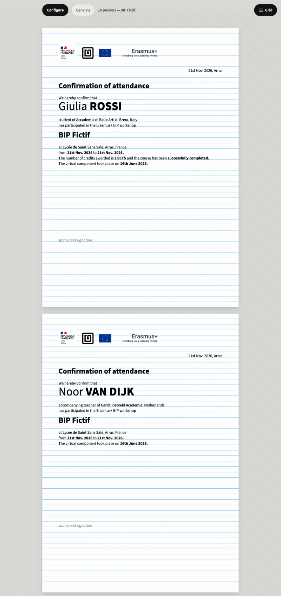
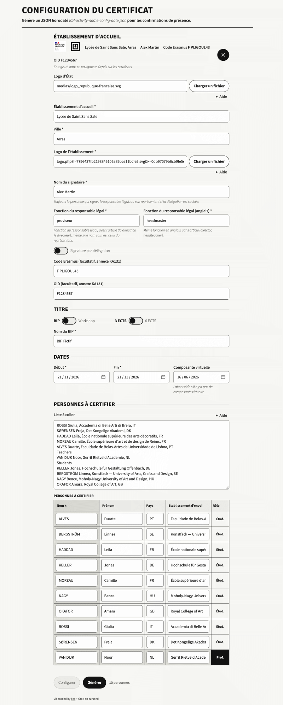
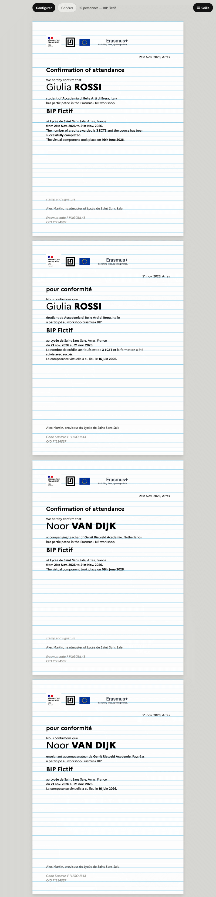

[English](#en) · [Français](#fr)

# ERASMUS confirmation of attendance

[en Français (par là)](#fr)

An online tool that generates confirmations of attendance for Blended Intensive Programmes (BIP) or plain Erasmus workshops. Ugly Word files are not an option.

The tool is two pages. Host it on a server (`https://`). The logo upload does not work over `file://`.

## Language

The HTML is English. A French overlay is applied when the active language is French.

1. In `js/langue.js`, `FORCE_LANG`: `"en"` or `"fr"` wins. Empty: the browser decides.
2. Otherwise `?lang=en` or `?lang=fr` forces that visit only. Nothing is stored. Other visitors are unchanged.
3. Otherwise the French interface opens only when the browser language list includes `fr-FR` and no other French region (`fr-BE`, `fr-LU`, `fr-CH`, …). A bare `fr`, `fr-BE`, `fr-LU` and every other language stay English. That international version is the one for French speakers outside France.

`document.documentElement.lang` and the `type="date"` fields follow the active language.

## Certificate

One A4 page per person. The foot of the page is a single line: stamp and signature. Typeface: **Source Sans 3**, baseline 1.375 rem (body 1 rem / 1.375 rem, title 2 rem / 2.75 rem, name 3 rem / 4.125 rem). No Erasmus code, no OID, no legal representative on screen or on the page.

## Configuration (`config.html`)

The first time, fill in the country logo, host institution, place and its logo. A state emblem sits next to it; it defaults to the French Republic mark and can be replaced. Those paths are stored in this browser and in the JSON you download.

Then paste the list of people (students and accompanying teachers), with optional sending institution and country. A table is rebuilt as you type. You can set the role (student / teacher) on each row. Students receive ECTS; teachers are recorded as accompanying, with no credits.

**Configure** and **Generate** switch panels. The button for the current view is grayed and does nothing; the other is the action. The page opens on the form. **Generate** validates, downloads a timestamped JSON (`version`: `v2`), then shows the A4 pages on the same page. **Configure** then brings the form back. **Grid** shows or hides the baseline lines. Printing from that view hides the form and the buttons.

You can drop a `.txt` list or a previously exported JSON onto the list field. The JSON reloads title, dates and people. Host fields already filled in the form stay as they are; empty ones take the JSON. Older internat files (`lycee`, `personnes`, `nom`, `prenom`, `proviseur`, `oid`) still open.

On save, the JSON sorts by institution, teachers then students, then by name. Empty keys are omitted, not written as empty strings.

## Certificates (`certificat.html`)

This page only prints a JSON that already exists. It opens on a single field: drop the file, or click the field to choose it. After a valid file, the A4 pages appear underneath; the field stays so you can load another. **Grid** remains. Printing hides the field and the button.

Print with **Command/Control + P** to get a PDF, then have the pages signed.

Set the activity type (**BIP** or **Workshop**); ECTS are added on student certificates (3 or 1).

The layout uses a baseline grid so the type sits on a structure. The blue lines are not printed. Baseline alignment follows [Julie Blanc](https://julie-blanc.fr/)’s work for [paged.js](https://pagedjs.org/).

The interface (forms, buttons, help) and the A4 pages use **Source Sans 3** (variable, version 3.052), SIL Open Font License, shipped in `fonts/source-sans/`.

- Drop lists or a previously exported JSON onto the configuration page.
- Sort the on-screen table by country, institution, name, or role. That sort does not reorder the JSON; the file uses the save order above.

No office suite to install. Open formats.

Vibecoded by [écb](mailto:ecb@dnmd.lv) (with Grok on Cursor).

---

# ERASMUS confirmation de présence

[English here](#en)

Outil en ligne pour générer des confirmations de présence de Blended Intensive Programmes (BIP) ou d’ateliers Erasmus sans BIP. Les fichiers Word illisibles ne sont pas une option.

L’outil tient en deux pages. L’héberger sur un serveur (`https://`). L’envoi d’un logo ne fonctionne pas en `file://`.

## Langue

Le HTML est en anglais. Une couche française s’applique quand la langue active est le français.

1. Dans `js/langue.js`, `FORCE_LANG` : `"en"` ou `"fr"` l’emporte. Vide : le navigateur décide.
2. Sinon `?lang=en` ou `?lang=fr` force cette visite seulement. Rien n’est mémorisé. Les autres visiteurs ne changent pas.
3. Sinon l’interface française s’ouvre seulement si la liste de langues du navigateur contient `fr-FR` et aucune autre région francophone (`fr-BE`, `fr-LU`, `fr-CH`, …). Un `fr` seul, `fr-BE`, `fr-LU` et toute autre langue restent en anglais. Cette version internationale est celle prévue pour les francophones hors de France.

`document.documentElement.lang` et les champs `type="date"` suivent la langue active.

## Anglais (défaut)

Le certificat est en anglais seulement : une page A4 par personne. Le pied de page est une seule ligne : stamp and signature. Police : **Source Sans 3**, grille de ligne de base 1,375 rem (labeur 1 rem / 1,375 rem, titre 2 rem / 2,75 rem, nom 3 rem / 4,125 rem). Ni code Erasmus, ni OID, ni responsable légal à l’écran ou sur la page. La langue de l’interface fixe police et grille de tous les A4.

## Français

Les mêmes adresses (`index.html`, `config.html`, `certificat.html`). Deux pages A4 par personne, recto anglais puis verso français. Le titre du verso est **pour conformité**. Pas de ligne « cachet et signature » sur le verso. Les deux pages utilisent **Marianne** et la grille internat 1,5 rem (labeur 1 rem / 1,5 rem, titre 2 rem / 3 rem, nom 3 rem / 4,5 rem). La ligne « stamp and signature » reste sur le recto anglais seulement. Signataire et codes, s’ils sont remplis, s’impriment sur les deux pages.

Le bloc établissement ajoute un seul nom de signataire, les fonctions du responsable légal (français avec article, anglais sans), un interrupteur « signature par délégation », et un code Erasmus / OID facultatifs (annexe KA131). Les codes vides sont omis du JSON et de la page. Les codes imprimés sont en italique, comme « stamp and signature ».

Délégation décochée : `Camille Martin, director of …` / `Camille Martin, directrice du …`. Délégation cochée : `For the director and by delegation, Alex Martin` / `Pour la directrice et par délégation, Alex Martin`. Le nom imprimé est toujours celui du champ signataire.

## Configuration (`config.html`)

La première fois, renseigner le logo d’État, l’établissement d’accueil, le lieu et son logo. Un emblème d’État est à côté ; par défaut la marque de la République française, remplaçable. Ces chemins sont gardés dans ce navigateur et dans le JSON téléchargé.

Coller ensuite la liste des personnes (étudiants et enseignants accompagnateurs), avec établissement d’envoi et pays facultatifs. Un tableau se reconstruit à la saisie. Le rôle (étudiant / enseignant) se règle sur chaque ligne. Les étudiants reçoivent des ECTS ; les enseignants sont enregistrés comme accompagnateurs, sans crédits.

**Configurer** et **Générer** basculent les panneaux. Le bouton de la vue courante est grisé, inactif ; l’autre est l’action. La page s’ouvre sur le formulaire. **Générer** valide, télécharge un JSON horodaté (`version` : `v2`), puis affiche les pages A4 sur la même page. **Configurer** ramène alors le formulaire. **Grille** montre ou cache les filets de ligne de base. L’impression depuis cette vue masque le formulaire et les boutons.

On peut déposer une liste `.txt` ou un JSON déjà exporté sur le champ liste. Le JSON recharge le titre, les dates et les personnes. Les champs établissement déjà saisis restent en place ; les vides prennent la valeur du JSON. Les anciens fichiers v1 (`lycee`, `personnes`, `nom`, `prenom`, `proviseur`, `oid`) s’ouvrent encore.

À l’enregistrement, le JSON classe par établissement, enseignants puis étudiants, puis par nom. Les clés vides sont omises, pas écrites comme chaînes vides.

## Certificats (`certificat.html`)

Cette page n’imprime qu’un JSON déjà existant. Elle s’ouvre sur un seul champ : déposer le fichier, ou cliquer pour le choisir. Après un fichier valide, les pages A4 apparaissent en dessous ; le champ reste pour en charger un autre. **Grille** demeure. L’impression masque le champ et le bouton.

Imprimer avec **Commande/Contrôle + P** pour obtenir un PDF, puis faire signer les pages.

Régler le type d’activité (**BIP** ou **Workshop**) ; les ECTS sont ajoutés sur les certificats étudiants (3 ou 1).

La mise en page utilise une grille de ligne de base pour caler le texte. Les filets bleus ne s’impriment pas. L’alignement des bas de ligne suit le travail de [Julie Blanc](https://julie-blanc.fr/) pour [paged.js](https://pagedjs.org/).

L’interface (formulaires, boutons, aide) utilise **Source Sans 3** (variable, version 3.052), SIL Open Font License, fournie dans `fonts/source-sans/`. En anglais, les A4 restent en Source Sans 3. L’interface française passe les A4 en Marianne (`fonts/marianne/`) et la grille de ligne de base afférente.

- Déposer des listes ou un JSON déjà exporté sur la page de configuration.
- Trier le tableau à l’écran par pays, établissement, nom ou rôle. Ce tri ne réordonne pas le JSON ; le fichier suit l’ordre d’enregistrement ci-dessus.

Aucune suite bureautique à installer. Formats ouverts.

Vibecodé par [écb](mailto:ecb@dnmd.lv) (avec Grok sur Cursor).
